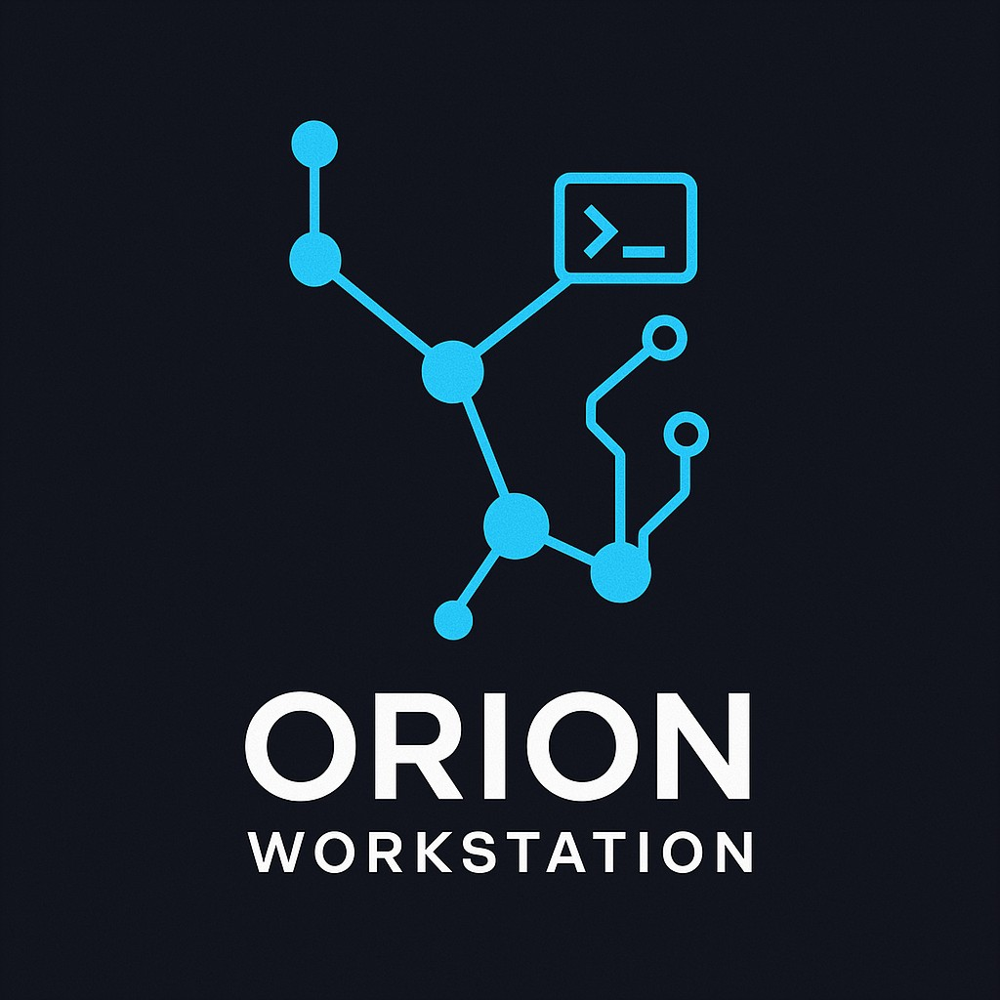
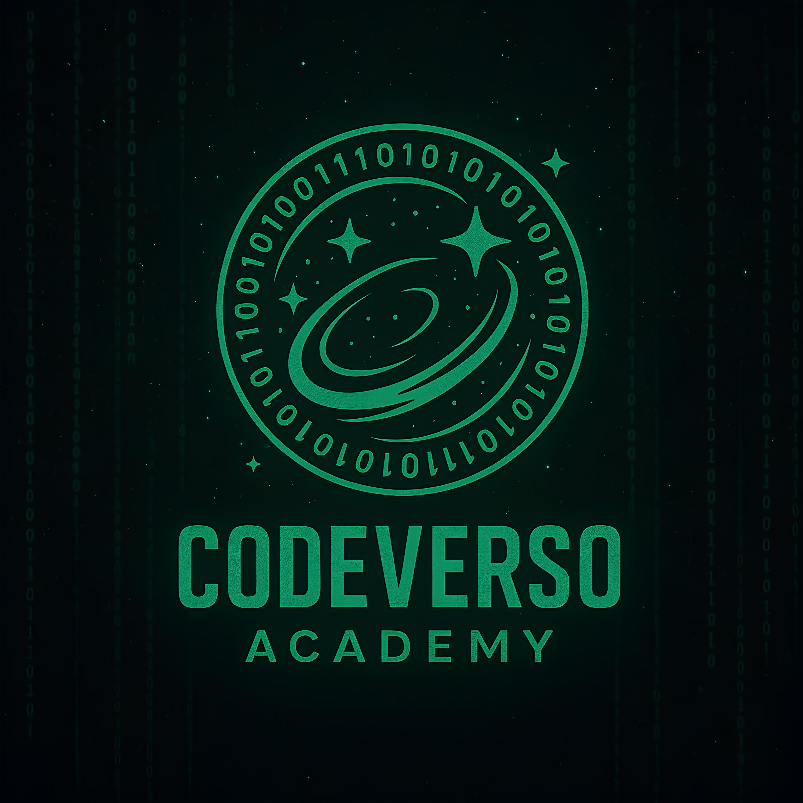

# 🌌💻⚙️ Orion Workstation on WSL2

<p align="center">
    
</p>

> Automatização para configuração de ambiente de desenvolvimento no WSL2 Ubuntu, utilizando Ansible para agilizar e padronizar a instalação de ferramentas e configurações essenciais para profissionais DevOps.
> "Automatize tudo o que puder, documente o resto."

_**Feito com ❤️ para otimizar o tempo de desenvolvedores DevOps**_

---

## 📑 Sumário
- [Sobre o Projeto](#-sobre-o-projeto)
- [Estrutura do Projeto](#-estrutura-do-projeto)
- [Roadmap](#-roadmap)
- [Funcionalidades](#-funcionalidades)
- [Pré-requisitos](#-pré-requisitos)
- [Instalação](#-instalação)
- [Configuração do Windows Terminal](#️-configuração-do-windows-terminal)
- [Configuração do Prompt (Powerlevel10k)](#-configuração-do-prompt-powerlevel10k)
- [Uso](#-uso)
- [Personalização de Instalação](#️-personalização-de-instalação)
- [Desfazendo as Alterações](#-desfazendo-as-alterações)
- [Verificação de Modificações](#-verificação-de-modificações)
- [Variáveis do Sistema](#-variáveis-do-sistema)
- [Licença](#-licença)
- [Contato](#-contato)

## 🚀 Sobre o Projeto

O *Orion Workstation* é um conjunto de automações para provisionar rapidamente um ambiente de desenvolvimento DevOps completo no WSL2 Ubuntu, utilizando Ansible. O objetivo é padronizar e acelerar a configuração de ferramentas essenciais, shells modernos, utilitários, ferramentas de containerização, infraestrutura como código e CLIs de nuvem, tudo de forma modular e personalizável.

Com este projeto, profissionais DevOps podem economizar tempo, evitar configurações manuais repetitivas e garantir ambientes consistentes entre diferentes máquinas e equipes. Cada etapa do setup pode ser ativada ou desativada conforme a necessidade, tornando o processo flexível e adaptável a diferentes cenários de uso.

## 📁 Estrutura do Projeto

```
.
├── LICENSE                          # Licença do projeto (MIT)
├── README.md                        # Documentação principal do projeto
├── ansible.cfg                      # Arquivo de configuração do Ansible
├── assets                           # Diretório para imagens e recursos visuais
│   ├── CodeVerso-Academy.jpg        # Logo da CodeVerso Academy
│   └── Orion-Workstation-Project.jpg # Logo do projeto Orion Workstation
├── check_workstation.py             # Script Python para verificar a instalação/rollback
├── collections                      # Definições de dependências de collections do Ansible
│   └── requirements.yml             # Lista de collections necessárias (ex: kubernetes.core)
├── inventory                        # Inventário do Ansible, define os hosts e variáveis
│   ├── group_vars                   # Variáveis aplicadas a grupos de hosts
│   │   └── all.yml                  # Variáveis globais para controlar a execução das roles
│   └── wsl.yml                      # Definição do host (localhost para WSL2)
├── playbooks                        # Playbooks principais para execução
│   ├── rollback.yml                 # Playbook para reverter todas as alterações
│   └── site.yml                     # Playbook principal que executa a configuração completa
└── roles                            # Diretório onde as roles de automação são armazenadas
    ├── cloud_cli                    # Role para instalar CLIs de provedores de nuvem (AWS, Azure, GCP)
    │   ├── defaults                 # Variáveis padrão para a role cloud_cli
    │   │   └── main.yml
    │   └── tasks                    # Tarefas de instalação das CLIs
    │       └── main.yml
    ├── docker_container             # Role para instalar e configurar o Docker
    │   ├── defaults                 # Variáveis padrão para a role docker_container
    │   │   └── main.yml
    │   ├── handlers                 # Handlers para reiniciar serviços (ex: Docker)
    │   │   └── main.yml
    │   └── tasks                    # Tarefas de instalação do Docker
    │       └── main.yml
    ├── iac                          # Role para instalar ferramentas de Infra as Code (Terraform, OpenTofu)
    │   ├── defaults                 # Variáveis padrão para a role iac
    │   │   └── main.yml
    │   └── tasks                    # Tarefas de instalação do Terraform e OpenTofu
    │       └── main.yml
    ├── kubernetes_orchestration     # Role para instalar o ecossistema Kubernetes
    │   ├── defaults                 # Variáveis padrão para a role kubernetes_orchestration
    │   │   └── main.yml
    │   ├── handlers                 # Handlers para reiniciar serviços (ex: containerd)
    │   │   └── main.yml
    │   └── tasks                    # Tarefas de instalação do Kubernetes, Helm, etc.
    │       └── main.yml
    ├── oh_my_zsh                    # Role para configurar o Zsh com Oh My Zsh
    │   ├── defaults                 # Variáveis padrão para a role oh_my_zsh
    │   │   └── main.yml
    │   └── tasks                    # Tarefas de instalação do Zsh e plugins
    │       └── main.yml
    ├── packages_optional            # Role para instalar pacotes opcionais do sistema
    │   ├── defaults                 # Variáveis padrão para a role packages_optional
    │   │   └── main.yml
    │   └── tasks                    # Tarefas de instalação dos pacotes
    │       └── main.yml
    └── update_system                # Role para atualizar o sistema operacional
        └── tasks                    # Tarefas de atualização e upgrade do sistema
            └── main.yml
```

## 🌍 Roadmap

Este projeto está em constante evolução para oferecer um ambiente DevOps cada vez mais completo. Ao longo de 2025, novas ferramentas e configurações serão integradas. Confira as etapas planejadas e em andamento:

- [x] Atualização e Upgrade do Sistema Operacional
- [x] Instalação de utilitários: Instalação de pacotes opcionais
- [x] Terminal Moderno: Instalação e Customização com Oh-My-ZSH, Powerlevel10k e Plugins
- [x] Containerização: Docker Engine e Docker Compose v2
- [x] Orquestração e Ferramentas Kubernetes: `kubectl`, `kubelet`, `kubeadm`, `minikube`, `helm`, `k9s`
- [x] Infraestrutura como Código: `Terraform` e `OpenTofu`
- [x] CLIs de Nuvem: `Azure CLI`, `AWS CLI`, `Google Cloud CLI`

> 🔄 *Este projeto está em manutenção ativa. Correções de bugs e atualizações de segurança continuarão a ser feitas, melhorias são adicionadas regularmente, mas novas funcionalidades não estão planejadas.Contribuições e sugestões são bem-vindas!*

## 💡 Funcionalidades

O playbook automatiza as seguintes configurações e instalações essenciais para um ambiente DevOps moderno:

1. **Atualização e aprimoramento do sistema operacional**
    - Atualização dos repositórios e pacotes
    - Upgrade de segurança e limpeza de dependências

2. **Instalação de utilitários**
    - Instalação de pacotes opcionais para o ambiente de desenvolvimento

3. **Terminal moderno**
    - Setup do Oh-My-ZSH com tema Powerlevel10k
    - Instalação e configuração de plugin (syntax highlighting)
    - Customização do prompt e variáveis de ambiente

4. **Containerização**
    - Instalação completa do Docker Engine e Docker Compose v2
    - Configuração de permissões em grupo para uso do Docker sem sudo

5. **Orquestração e ferramentas Kubernetes**
    - Instalação do kubectl, kubelet, kubeadm, minikube, helm e k9s

6. **Infraestrutura como Código**
    - Instalação do Terraform e OpenTofu

7. **Ferramentas de Cloud CLI**
    - Instalação do AWS CLI, Azure CLI e Google Cloud CLI


> Todas as etapas são opcionais e podem ser customizadas conforme a necessidade do usuário, garantindo flexibilidade e padronização do ambiente.

## 📋 Pré-requisitos

- WSL2 instalado com Ubuntu
- Acesso à internet
- Privilégios de administrador
- Windows Terminal (recomendado)

## 🔧 Instalação

### 1. Instalar o Ansible e suas dependências

```bash
# Atualizar os repositórios
sudo apt update

# Instalar o software-properties-common
sudo apt install software-properties-common

# Adicionar o repositório do Ansible
sudo apt-add-repository --yes --update ppa:ansible/ansible

# Instalar o Ansible
sudo apt install ansible
```

### 2. Clonar o Repositório

```bash
git clone https://github.com/messias-code/orion-workstation
cd orion-workstation
```

### 3. Instalar as Dependências (Collections)
O projeto utiliza collections do Ansible Galaxy para estender suas funcionalidades. Instale todas as dependências necessárias com um único comando, utilizando o arquivo de requerimentos.

```bash
ansible-galaxy collection install -r collections/requirements.yml
```

## 🖥️ Configuração do Windows Terminal

1. Baixe a fonte MesloLGS NF:
    - [Download MesloLGS NF Regular](https://github.com/romkatv/powerlevel10k-media/raw/master/MesloLGS%20NF%20Regular.ttf)

2. Instale a fonte:
    - Clique duas vezes no arquivo baixado
    - Clique em "Instalar"

3. Configure o Windows Terminal:
    - Abra as Configurações (Ctrl+,)
    - Selecione seu perfil do Ubuntu
    - Em "Aparência"
    - Mude a fonte para "MesloLGS NF"
    
4. Configure o tema Catppuccin Mocha:
    - Abra as Configurações (Ctrl+,)
    - Clique em "Abrir arquivo JSON"
    - Adicione o seguinte esquema de cores na seção "schemes":
    ```json
    {
       "name": "Catppuccin Mocha",
       "cursorColor": "#F5E0DC",
       "selectionBackground": "#585B70",
       "background": "#1E1E2E",
       "foreground": "#CDD6F4",
       "black": "#45475A",
       "red": "#F38BA8",
       "green": "#A6E3A1",
       "yellow": "#F9E2AF",
       "blue": "#89B4FA",
       "purple": "#F5C2E7",
       "cyan": "#94E2D5",
       "white": "#BAC2DE",
       "brightBlack": "#585B70",
       "brightRed": "#F38BA8",
       "brightGreen": "#A6E3A1",
       "brightYellow": "#F9E2AF",
       "brightBlue": "#89B4FA",
       "brightPurple": "#F5C2E7",
       "brightCyan": "#94E2D5",
       "brightWhite": "#A6ADC8"
    }
    ```
    - No seu perfil do Ubuntu, defina o esquema de cores como "Catppuccin Mocha"

## 🎨 Configuração do Prompt (Powerlevel10k)

O prompt do terminal é gerenciado pelo [Powerlevel10k](https://github.com/romkatv/powerlevel10k). As preferências ficam salvas no arquivo `~/.p10k.zsh`.

### Configurar

O assistente de configuração é iniciado automaticamente na primeira execução do ZSH. Para executá-lo manualmente a qualquer momento:

```bash
p10k configure
```

Siga as perguntas do assistente (ícones, estilo do prompt, cores, etc.). Ao final, escolha salvar para gravar as alterações no `~/.zshrc` e no `~/.p10k.zsh`.

> **Dica:** Se os ícones aparecerem quebrados, confira se a fonte `MesloLGS NF` está configurada no [Windows Terminal](#️-configuração-do-windows-terminal).

### Resetar

Para descartar a configuração atual e começar do zero:

```bash
# Remover o arquivo de configuração atual do Powerlevel10k
rm -f ~/.p10k.zsh

# Recarregar o ZSH (o assistente será iniciado novamente)
exec zsh
```

Caso o assistente não inicie automaticamente, execute `p10k configure` manualmente.

> **Nota:** O `p10k configure` também cria um backup do `~/.zshrc` antes de alterá-lo. Se precisar, procure por arquivos `~/.zshrc.bak*`.

## 📦 Uso

Para executar o playbook:

```bash
ansible-playbook playbooks/site.yml --ask-become-pass
```

> **OBS: A senha é do seu usuário root**

Após a execução:
1. Certifique-se que a fonte está configurada no Windows Terminal [Configuração do Terminal](#️-configuração-do-windows-terminal)
2. Reinicie o terminal para que as alterações tenham efeito
3. Configure o tema Powerlevel10k na primeira execução do ZSH ([Configuração do Prompt](#-configuração-do-prompt-powerlevel10k))

O script exibirá um relatório com o status dos principais componentes instalados pelo playbook.

## 🎛️ Personalização de Instalação

Você tem controle total sobre o que é instalado. Edite o arquivo `inventory/group_vars/all.yml` e defina como `true` ou `false` cada uma das seções para ativar ou desativar a role correspondente.

```YAML
setup:
    update_system: true
    packages_optional: true
    oh_my_zsh: true
    docker_container: true
    kubernetes_orchestration: true
    iac: true
    cloud_cli: true
```

## 🔄 Desfazendo as Alterações

Caso precise reverter as configurações aplicadas pelo playbook, utilize o script de rollback fornecido no projeto. Ele tentará desfazer todas as alterações realizadas durante a instalação, independentemente de quais componentes foram instalados originalmente.

### 1. Execute o playbook de reversão

```bash
ansible-playbook playbooks/rollback.yml
```

> **Nota:** O rollback executa a remoção de todos os componentes gerenciados pelo playbook, mesmo que alguns não tenham sido instalados. Isso não causa problemas, pois o Ansible ignora etapas de remoção para itens ausentes.

### 2. Reinicie o terminal

Após a execução do rollback, reinicie o terminal para garantir que todas as alterações sejam aplicadas corretamente.

Se necessário, revise o arquivo `rollback.yml` para personalizar etapas específicas de reversão conforme seu ambiente.

## 🧪 Verificação de Modificações

Para verificar detalhadamente o status da instalação ou do rollback, utilize o script de verificação incluso no projeto. Basta executar o comando abaixo e escolher entre `install` ou `rollback` conforme a ação desejada:

```bash
python3 check_workstation.py [install | rollback]
```

O script exibirá um relatório com o status dos principais componentes do ambiente, facilitando o acompanhamento das alterações realizadas.

## 🔍 Variáveis do Sistema

O Ansible utiliza "facts" para coletar informações do sistema. As principais variáveis utilizadas neste playbook são:

| Variável                      | Comando para Verificar                        | Descrição                                                                                   |
|-------------------------------|-----------------------------------------------|---------------------------------------------------------------------------------------------|
| `ansible_env.USER`            | `whoami` ou `echo $USER`                      | Nome do usuário atual                                                                       |
| `ansible_user_id`             | `id -u`                                       | ID do usuário atual                                                                         |
| `ansible_distribution_release`| `lsb_release -cs`                             | Nome da versão do Ubuntu                                                                    |
| `ansible_env.SHELL`           | `echo $SHELL`                                 | Caminho do shell padrão do usuário                                                          |
| `ansible_facts.services`      | `systemctl list-units --type=service`         | Dicionário com os serviços do sistema, usado para verificar se um serviço existe            |

## 📝 Licença

Este projeto está sob a licença MIT. Veja o arquivo [LICENSE](LICENSE) para mais detalhes.

## 📩 Contato

Fique à vontade para acompanhar o projeto, tirar dúvidas ou trocar ideias comigo:

<p align="center">
    <a href="mailto:codeverso.academy@gmail.com" target="_blank">
        
        </a>
        <a href="https://www.linkedin.com/in/ihanmessias/" target="_blank">
        
    </a>

</p>

<p align="center">
    <a href="https://www.youtube.com/@codeversoacademy" target="_blank">
        
    </a>
</p>

<p align="center">© CodeVerso Academy</p>